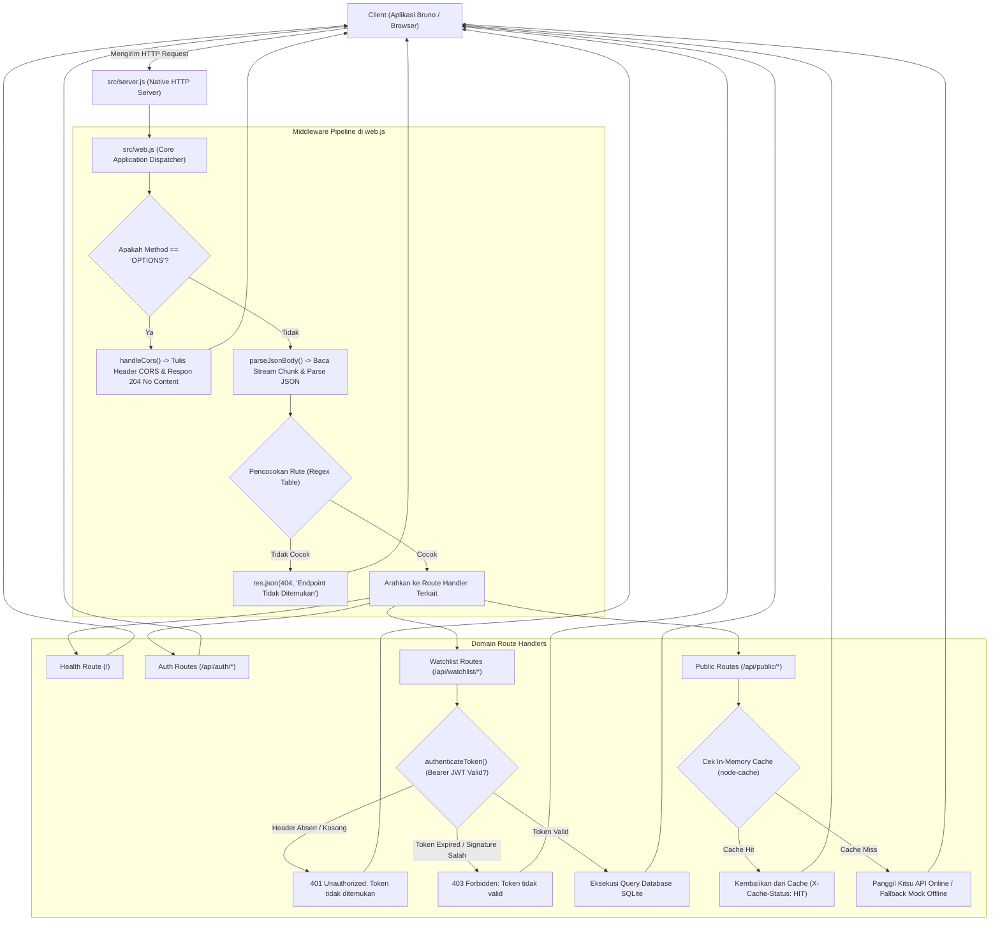
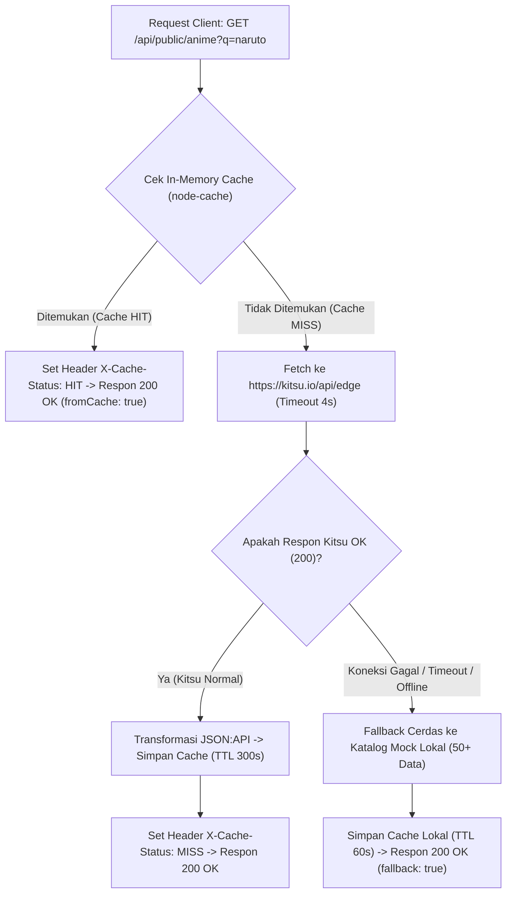
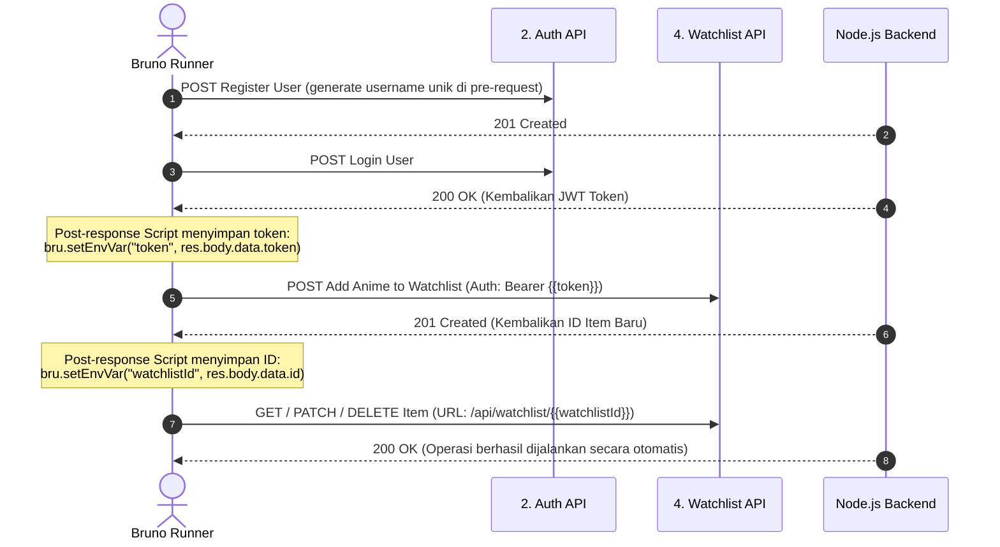

# DOKUMENTASI TEKNIS: ALUR SISTEM, IMPLEMENTASI KODE PER KONDISI, DAN PENGUJIAN API DI BRUNO

**Mata Kuliah:** Rekayasa API  
**Proyek:** Anime & Manga Watchlist Tracker API  
**Arsitektur:** Native Node.js (`node:http`), SQLite (`node:sqlite DatabaseSync`), JWT, In-Memory Caching (`node-cache`), Kitsu API Gateway  
**API Client:** Bruno Desktop Client  

---

## DAFTAR ISI
1. [BAGIAN I: ALUR PROJECT & IMPLEMENTASI KODE SETIAP KONDISI](#bagian-i-alur-project--implementasi-kode-setiap-kondisi)
   - [1.1 Arsitektur Sistem & Siklus Hidup Permintaan (Request Lifecycle)](#11-arsitektur-sistem--siklus-hidup-permintaan-request-lifecycle)
   - [1.2 Penanganan Kondisi pada Middleware (CORS, Body Parser, Auth)](#12-penanganan-kondisi-pada-middleware)
   - [1.3 Penanganan Kondisi pada Modul Autentikasi (Register & Login)](#13-penanganan-kondisi-pada-modul-autentikasi)
   - [1.4 Penanganan Kondisi pada Katalog Publik (Kitsu Gateway & Cache)](#14-penanganan-kondisi-pada-katalog-publik)
   - [1.5 Penanganan Kondisi pada Modul Watchlist (CRUD & Validasi)](#15-penanganan-kondisi-pada-modul-watchlist)
2. [BAGIAN II: ALUR DAN KONDISI PENGUJIAN PADA BRUNO](#bagian-ii-alur-dan-kondisi-pengujian-pada-bruno)
   - [2.1 Konsep Otomasi & Environment Bruno (Zero-Config Chaining)](#21-konsep-otomasi--environment-bruno)
   - [2.2 Rincian Alur dan Kondisi Tes Berdasarkan Screenshot Koleksi Bruno](#22-rincian-alur-dan-kondisi-tes-berdasarkan-screenshot-koleksi-bruno)
     - [Folder 1: System Health Check](#folder-1-system-health-check)
     - [Folder 2: Auth API](#folder-2-auth-api)
     - [Folder 3: Public Catalog API](#folder-3-public-catalog-api)
     - [Folder 4: Watchlist API](#folder-4-watchlist-api)

---

# BAGIAN I: ALUR PROJECT & IMPLEMENTASI KODE SETIAP KONDISI

Aplikasi ini dibangun murni menggunakan modul standar bawaan **Node.js (`node:http`) tanpa framework Express**, dipadukan dengan database lokal performa tinggi **`node:sqlite` (`DatabaseSync`)**, enkripsi sandi **`bcryptjs`**, otorisasi **`jsonwebtoken` (JWT)**, serta integrasi **Kitsu API (Edge Specification)** dengan *in-memory cache*.



---

### 1.1 Arsitektur Sistem & Siklus Hidup Permintaan (Request Lifecycle)

1. **Inisialisasi Runtime ([`src/server.js`](file:///D:/TUBES%20API/tubes-matkul-api/src/server.js))**:
   - Membaca environment variable dari `.env` secara native via `process.loadEnvFile()`.
   - Menginisialisasi skema tabel database SQLite melalui [`initDatabase()`](file:///D:/TUBES%20API/tubes-matkul-api/src/db/database.js#L16-L49).
   - Menjalankan native HTTP server pada `http://localhost:3000` dengan mendelegasikan callback request ke fungsi [`web(req, res)`](file:///D:/TUBES%20API/tubes-matkul-api/src/web.js#L72-L136).

2. **Dispatcher Pusat ([`src/web.js`](file:///D:/TUBES%20API/tubes-matkul-api/src/web.js))**:
   - Mengekstrak `req.pathname` dan parameter query `req.query`.
   - Menyuntikkan helper respons standar `res.json(statusCode, data)` yang otomatis melampirkan header JSON dan CORS, serta mencatat log durasi pemrosesan (latency dalam milidetik).
   - Menjalankan middleware CORS, membaca payload stream body, mencocokkan regex rute, dan mengeksekusi handler.

---

### 1.2 Penanganan Kondisi pada Middleware

#### A. Middleware CORS ([`src/middleware/cors.js`](file:///D:/TUBES%20API/tubes-matkul-api/src/middleware/cors.js))

Menangani izin akses lintas domain (*Cross-Origin Resource Sharing*).

```javascript
export function handleCors(req, res) {
  res.setHeader('Access-Control-Allow-Origin', '*');
  res.setHeader('Access-Control-Allow-Headers', 'Content-Type, Authorization');
  res.setHeader('Access-Control-Allow-Methods', 'GET, POST, PATCH, DELETE, OPTIONS');

  if (req.method === 'OPTIONS') {
    res.writeHead(204);
    res.end();
    return true; 
  }

  return false;
}
```

* **Kondisi 1 (`req.method === 'OPTIONS'`)**: Browser/client mengirimkan request preflight sebelum operasi mutasi data. Server langsung menulis header izin dan merespons status `204 No Content` tanpa membaca body ataupun meneruskan ke router (`return true`).
* **Kondisi 2 (Method lainnya: GET, POST, PATCH, DELETE)**: Server menyematkan header CORS dan mengembalikan nilai `false` agar request diteruskan ke middleware berikutnya.

---

#### B. Middleware Body Parser Stream ([`src/middleware/bodyParser.js`](file:///D:/TUBES%20API/tubes-matkul-api/src/middleware/bodyParser.js))

Membaca chunk stream biner request dan mengubahnya menjadi objek JSON.

* **Kondisi 1 (Method yang tidak membawa body)**: Jika method bukan `POST`, `PATCH`, atau `PUT`, fungsi langsung `resolve()` dan menginisialisasi `req.body = {}`.
* **Kondisi 2 (`Content-Type` bukan JSON)**: Jika header `content-type` tidak mengandung `application/json`, parsing diabaikan dan `req.body = {}`.
* **Kondisi 3 (Proteksi Buffer > 1 MB)**: Mengakumulasi panjang byte tiap chunk. Jika total byte melampaui `1024 * 1024` (1 MB), koneksi langsung diputus dengan `req.destroy()` dan memicu error `413 Payload Too Large`.
* **Kondisi 4 (Format JSON Rusak / Malformed)**: Jika string payload gagal diparsing oleh `JSON.parse()`, blok `catch` melempar error dengan `statusCode = 400` ("Format JSON di request body tidak valid.").
* **Kondisi 5 (JSON Valid)**: Hasil parsing sukses disimpan ke properti `req.body` dan request dilanjutkan.

---

#### C. Middleware Autentikasi JWT ([`src/middleware/auth.js`](file:///D:/TUBES%20API/tubes-matkul-api/src/middleware/auth.js))

Mengamankan rute privat watchlist dengan memverifikasi header `Authorization: Bearer <token>`.

```javascript
export function authenticateToken(req, res) {
  const authHeader = req.headers['authorization'];
  const token = authHeader && authHeader.split(' ')[1];

  if (!token) {
    logger.warn('AUTH', 'Akses ditolak: Header Authorization Bearer tidak ditemukan');
    res.json(401, { success: false, message: 'Akses ditolak: Token autentikasi tidak ditemukan.' });
    return false;
  }

  try {
    const decoded = jwt.verify(token, JWT_SECRET);
    req.user = decoded; // Berisi { id, username }
    return true;
  } catch (err) {
    logger.warn('AUTH', `Token tidak valid atau kedaluwarsa: ${err.message}`);
    res.json(403, { success: false, message: 'Token tidak valid atau telah kedaluwarsa.' });
    return false;
  }
}
```

* **Kondisi 1 (Header Authorization absen atau token kosong)**: Mengembalikan respons status `401 Unauthorized`.
* **Kondisi 2 (Token kedaluwarsa atau signature secret tidak valid)**: Pengecekan `jwt.verify()` melempar exception $\rightarrow$ merespons status `403 Forbidden`.
* **Kondisi 3 (Token sah dan aktif)**: Payload hasil dekripsi disematkan ke objek `req.user` (`{ id, username }`) dan mengembalikan nilai `true`.

---

### 1.3 Penanganan Kondisi pada Modul Autentikasi ([`src/routes/auth.js`](file:///D:/TUBES%20API/tubes-matkul-api/src/routes/auth.js))

#### A. Registrasi Pengguna (`handleRegister`)
1. **Kondisi 1 (Kelengkapan Data):** Jika `!username || !password` $\rightarrow$ Respon `400 Bad Request` ("Username dan password wajib diisi.").
2. **Kondisi 2 (Panjang Username):** Jika `cleanUsername.length < 3` $\rightarrow$ Respon `400 Bad Request` ("Username minimal harus 3 karakter.").
3. **Kondisi 3 (Panjang Password):** Jika `password.length < 6` $\rightarrow$ Respon `400 Bad Request` ("Password minimal harus 6 karakter.").
4. **Kondisi 4 (Pemeriksaan Duplikasi Username):** Menjalankan query `SELECT id FROM users WHERE username = ?`. Jika record ditemukan $\rightarrow$ Respon `409 Conflict` ("Username sudah digunakan, silakan gunakan username lain.").
5. **Kondisi 5 (Sukses):** Password di-hash menggunakan `bcrypt.hash(password, 10)`, disimpan ke SQLite, dan merespons `201 Created` beserta metadata `userId` dan `username`.

#### B. Login Pengguna (`handleLogin`)
1. **Kondisi 1 (Payload Kosong):** Jika `!username || !password` $\rightarrow$ Respon `400 Bad Request`.
2. **Kondisi 2 (User Tidak Ditemukan):** Query ke database tidak menghasilkan baris data $\rightarrow$ Respon `401 Unauthorized` ("Username atau password salah.").
3. **Kondisi 3 (Password Tidak Cocok):** `await bcrypt.compare(password, user.password_hash)` bernilai `false` $\rightarrow$ Respon `401 Unauthorized`.
4. **Kondisi 4 (Sukses):** Menerbitkan JSON Web Token (JWT) dengan masa kedaluwarsa 7 hari, merespons `200 OK` berisikan `token` dan data user.

---

### 1.4 Penanganan Kondisi pada Katalog Publik ([`src/routes/public.js`](file:///D:/TUBES%20API/tubes-matkul-api/src/routes/public.js) & [`src/services/kitsu.js`](file:///D:/TUBES%20API/tubes-matkul-api/src/services/kitsu.js))

Mengambil data anime dan manga dari Kitsu API dengan mekanisme ketahanan tinggi (*high availability & caching*).



* **Kondisi 1 (Cache HIT):** Data query/ID telah tersimpan di memory. Dikembalikan secara instan (< 2ms) dengan header `X-Cache-Status: HIT` dan flag `fromCache: true`.
* **Kondisi 2 (Cache MISS & Kitsu Online):** Data belum dicache. Server menghubungi Kitsu API via network call dengan proteksi pembatalan `AbortController` (timeout 4 detik). Respons diubah ke model data seragam, disimpan ke cache memori (TTL 300 detik), dan dikembalikan dengan header `X-Cache-Status: MISS`.
* **Kondisi 3 (Kitsu Down / Jaringan Terputus / Timeout):** Blok `catch` menangkap error dan mengalihkan request secara otomatis ke modul katalog cadangan lokal ([`getMockFallback`](file:///D:/TUBES%20API/tubes-matkul-api/src/services/kitsu.js#L445-L496)) yang memuat 50+ anime dan manga terpopuler dunia. API tetap merespons status `200 OK` tanpa pernah mengalami error 500.

---

### 1.5 Penanganan Kondisi pada Modul Watchlist ([`src/routes/watchlist.js`](file:///D:/TUBES%20API/tubes-matkul-api/src/routes/watchlist.js))

Semua request wajib lolos verifikasi [`authenticateToken`](file:///D:/TUBES%20API/tubes-matkul-api/src/middleware/auth.js#L9). Data selalu difilter berdasarkan `user_id = req.user.id` sehingga pengguna tidak dapat membaca, mengubah, atau menghapus item milik pengguna lain.

#### A. Tambah Item Watchlist (`handleCreateWatchlist`)
* **Kondisi 1 (Field Wajib Tidak Lengkap):** Jika `!mal_id || !item_type || !title` $\rightarrow$ `400 Bad Request`.
* **Kondisi 2 (Tipe Media Salah):** `item_type` bukan `'anime'` atau `'manga'` $\rightarrow$ `400 Bad Request` ("item_type harus berupa: anime atau manga.").
* **Kondisi 3 (Status Menonton Salah):** `status` tidak terdapat pada daftar `plan_to_watch`, `watching`, `completed`, `dropped` $\rightarrow$ `400 Bad Request`.
* **Kondisi 4 (Skor di Luar Batas):** `score < 0 || score > 10` $\rightarrow$ `400 Bad Request`.
* **Kondisi 5 (Pencegahan Duplikasi):** Mengecek apakah user sudah menyimpan judul yang sama (`SELECT id FROM watchlist_items WHERE user_id = ? AND mal_id = ? AND item_type = ?`). Jika ditemukan $\rightarrow$ `409 Conflict` ("Judul ini sudah ada di dalam watchlist kamu.").
* **Kondisi 6 (Sukses):** Data di-insert ke tabel SQLite dan merespons status `201 Created` beserta objek entitas yang baru dibuat.

#### B. Mengambil Seluruh Item Watchlist (`handleGetWatchlist`)
* **Kondisi 1 (Query Parameter `type` Tidak Valid):** Jika dikirim selain `'anime'` atau `'manga'` $\rightarrow$ `400 Bad Request`.
* **Kondisi 2 (Query Parameter `status` Tidak Valid):** Jika dikirim selain status resmi $\rightarrow$ `400 Bad Request`.
* **Kondisi 3 (Sukses):** Menyusun query SQL dinamis terfilter `user_id`, mengurutkan berdasarkan `updated_at DESC`, dan mengembalikan status `200 OK`.

#### C. Mengambil Item Berdasarkan ID (`handleGetWatchlistById`)
* **Kondisi 1 (Item Tidak Ditemukan / Bukan Milik User):** Query `SELECT * FROM watchlist_items WHERE id = ? AND user_id = ?` menghasilkan `undefined` $\rightarrow$ `404 Not Found`.
* **Kondisi 2 (Item Ditemukan):** Mengembalikan data item dengan status `200 OK`.

#### D. Memperbarui Item Watchlist (`handleUpdateWatchlist`)
* **Kondisi 1 (Item Tidak Ditemukan):** Verifikasi kepemilikan gagal $\rightarrow$ `404 Not Found`.
* **Kondisi 2 (Validasi Parsial Kolom):**
  - Jika mengubah `status` dan nilainya tidak valid $\rightarrow$ `400 Bad Request`.
  - Jika mengubah `progress` dan nilainya bukan angka atau `< 0` $\rightarrow$ `400 Bad Request`.
  - Jika mengubah `score` dan nilainya di luar rentang `0 - 10` $\rightarrow$ `400 Bad Request`.
* **Kondisi 3 (Tidak Ada Field yang Dikirim):** Request body `{}` tidak memiliki kolom pembaruan $\rightarrow$ `400 Bad Request` ("Tidak ada field yang diubah.").
* **Kondisi 4 (Sukses):** Membangun statement SQL UPDATE dinamis hanya untuk kolom yang dikirim, memperbarui `updated_at`, dan merespons data teranyar dengan status `200 OK`.

#### E. Menghapus Item Watchlist (`handleDeleteWatchlist`)
* **Kondisi 1 (ID Tidak Ditemukan / Bukan Milik User):** `result.changes === 0` $\rightarrow$ `404 Not Found`.
* **Kondisi 2 (Sukses Terhapus):** Baris data berhasil dihapus $\rightarrow$ `200 OK` ("Item watchlist berhasil dihapus.").

---

# BAGIAN II: ALUR DAN KONDISI PENGUJIAN PADA BRUNO

Bagian ini menguraikan struktur pengujian pada koleksi Bruno sesuai dengan screenshot navigasi:

```
Anime & Manga Watchlist Tracker API
├── 1. System Health Check
│   ├── GET 1. GET Health Check - 200
│   ├── OPT 2. OPTIONS CORS Preflight - 204
│   └── GET 3. GET Endpoint Not Found - 404
├── 2. Auth API
│   ├── POST 1. POST Register User - 201
│   ├── POST 2. POST Register Validation Error - 400
│   ├── POST 3. POST Register Duplicate Username - 409
│   ├── POST 4. POST Login User - 200
│   ├── POST 5. POST Login Invalid Credentials - 401
│   └── POST 6. POST Login Missing Body - 400
├── 3. Public Catalog API
│   ├── GET 1. GET Search Anime - 200
│   ├── GET 2. GET Search Anime Default - 200
│   ├── GET 3. GET Anime Detail by ID - 200
│   ├── GET 4. GET Search Manga - 200
│   └── GET 5. GET Manga Detail by ID - 200
└── 4. Watchlist API
    ├── POST 1. POST Add Anime to Watchlist - 201
    ├── POST 2. POST Add Duplicate Watchlist - 409
    ├── POST 3. POST Add Watchlist Validation Error - 400
    ├── GET  4. GET All Watchlist Items - 200
    ├── GET  5. GET Filtered Watchlist - 200
    ├── GET  6. GET Watchlist Item by ID - 200
    ├── GET  7. GET Watchlist Item Not Found - 404
    ├── PATCH 8. PATCH Update Watchlist Item - 200
    ├── PATCH 9. PATCH Update Watchlist Validation Error - 400
    ├── DELETE 10. DELETE Watchlist Item - 200
    ├── DELETE 11. DELETE Watchlist Item Not Found - 404
    └── GET  12. GET Watchlist Unauthorized - 401
```

---

### 2.1 Konsep Otomasi & Environment Bruno

Pengujian dirancang dengan prinsip **Zero-Configuration Chaining**, di mana data dari hasil pengujian sebelumnya dialirkan otomatis ke pengujian berikutnya menggunakan variabel environment:

* **Environment `Local` (`bruno/environments/Local.bru`)**:
  - `baseUrl`: `http://localhost:3000`
  - `testPassword`: `passwordrahasia123`
  - `testUsername`: Diisi otomatis oleh pre-request script.
  - `token`: Diisi otomatis setelah request Login sukses.
  - `watchlistId`: Diisi otomatis setelah penambahan item Watchlist sukses.



---

### 2.2 Rincian Alur dan Kondisi Tes Berdasarkan Screenshot Koleksi Bruno

#### FOLDER 1: System Health Check

Menguji kesiapan runtime server, dukungan CORS, dan routing fallback dasar.

| No | Request Name | Method & Endpoint | Ekspektasi Status | Kondisi & Assertion yang Diuji |
| :---: | :--- | :--- | :---: | :--- |
| **1** | `1. GET Health Check - 200` | `GET {{baseUrl}}/` | `200 OK` | **Positif**: Memeriksa respons root server. Respon harus memiliki properti `status: "online"`, `version: "1.0.0"`, nama aplikasi, dan daftar endpoint metadata. |
| **2** | `2. OPTIONS CORS Preflight - 204` | `OPTIONS {{baseUrl}}/api/watchlist` | `204 No Content` | **Positif**: Menguji protokol preflight CORS browser. Header `access-control-allow-origin` wajib bernilai `*` dan `access-control-allow-methods` mengizinkan `GET, POST, PATCH, DELETE`. |
| **3** | `3. GET Endpoint Not Found - 404` | `GET {{baseUrl}}/endpoint-tidak-ada` | `404 Not Found` | **Negatif**: Menguji request ke endpoint fiktif. Server wajib merespons `404 Not Found` dengan `success: false` dan pesan deskriptif. |

---

#### FOLDER 2: Auth API

Menguji seluruh alur autentikasi, validasi data pengguna, pencegahan duplikasi, dan penangkapan token JWT.

| No | Request Name | Method & Endpoint | Ekspektasi Status | Kondisi & Assertion yang Diuji |
| :---: | :--- | :--- | :---: | :--- |
| **1** | `1. POST Register User - 201` | `POST {{baseUrl}}/api/auth/register` | `201 Created` | **Positif**: Script pre-request membuat `testUsername` unik secara acak. Menguji registrasi sukses, verifikasi `success: true`, dan memeriksa bahwa field `data.userId` bertipe *number*. |
| **2** | `2. POST Register Validation Error - 400` | `POST {{baseUrl}}/api/auth/register` | `400 Bad Request` | **Negatif (Validasi)**: Mengirimkan password pendek (`123`). Server wajib menolak dengan `400 Bad Request` dan pesan minimal 6 karakter. |
| **3** | `3. POST Register Duplicate Username - 409` | `POST {{baseUrl}}/api/auth/register` | `409 Conflict` | **Negatif (Duplikasi)**: Mencoba mendaftarkan kembali `testUsername` yang baru dibuat pada request 1. Database mendeteksi duplikasi username dan menolak dengan status `409 Conflict`. |
| **4** | `4. POST Login User - 200` | `POST {{baseUrl}}/api/auth/login` | `200 OK` | **Positif (Token Chaining)**: Login dengan kredensial valid. Server menerbitkan JWT. Script post-response mengekstrak `res.body.data.token` dan menyimpannya ke variabel `{{token}}`. |
| **5** | `5. POST Login Invalid Credentials - 401` | `POST {{baseUrl}}/api/auth/login` | `401 Unauthorized` | **Negatif (Kredensial Salah)**: Login dengan password keliru (`wrongPassword123`). Server menolak autentikasi dengan status `401 Unauthorized`. |
| **6** | `6. POST Login Missing Body - 400` | `POST {{baseUrl}}/api/auth/login` | `400 Bad Request` | **Negatif (Payload Kosong)**: Mengirim request body kosong `{}`. Server menolak dengan respons `400 Bad Request` ("Username dan password wajib diisi."). |

---

#### FOLDER 3: Public Catalog API

Menguji konsumsi API eksternal (Kitsu API Edge Specification), parsing JSON:API, dan verifikasi header in-memory cache.

| No | Request Name | Method & Endpoint | Ekspektasi Status | Kondisi & Assertion yang Diuji |
| :---: | :--- | :--- | :---: | :--- |
| **1** | `1. GET Search Anime - 200` | `GET {{baseUrl}}/api/public/anime?q=naruto&limit=5` | `200 OK` | **Positif**: Pencarian katalog anime spesifik dengan batas limit. Memeriksa array hasil pencarian memiliki panjang 5, memuat gambar, skor, dan episode, serta menyematkan header `X-Cache-Status`. |
| **2** | `2. GET Search Anime Default - 200` | `GET {{baseUrl}}/api/public/anime` | `200 OK` | **Positif**: Pengambilan anime terpopuler default tanpa parameter query pencarian. Memastikan data array tidak kosong. |
| **3** | `3. GET Anime Detail by ID - 200` | `GET {{baseUrl}}/api/public/anime/11` | `200 OK` | **Positif**: Mengambil data detail satu anime (Kitsu ID 11 - Naruto). Memeriksa entitas tunggal dengan field judul dan synopsis. |
| **4** | `4. GET Search Manga - 200` | `GET {{baseUrl}}/api/public/manga?q=one piece&limit=5` | `200 OK` | **Positif**: Pencarian katalog manga spesifik. Memeriksa format data manga yang menyertakan informasi bab/chapter dan volume. |
| **5** | `5. GET Manga Detail by ID - 200` | `GET {{baseUrl}}/api/public/manga/35` | `200 OK` | **Positif**: Mengambil detail satu manga berdasarkan ID (Kitsu ID 35). Mengonfirmasi bahwa data yang kembali sesuai dengan entitas manga terkait. |

---

#### FOLDER 4: Watchlist API

Menguji seluruh siklus hidup CRUD data privat watchlist dengan autentikasi Bearer JWT dan pengujian kasus batas (*edge cases*).

| No | Request Name | Method & Endpoint | Ekspektasi Status | Kondisi & Assertion yang Diuji |
| :---: | :--- | :--- | :---: | :--- |
| **1** | `1. POST Add Anime to Watchlist - 201` | `POST {{baseUrl}}/api/watchlist` | `201 Created` | **Positif (ID Chaining)**: Menambah anime ke watchlist dengan header `Authorization: Bearer {{token}}`. Script post-response menangkap `res.body.data.id` dan menyimpannya ke variabel `{{watchlistId}}`. |
| **2** | `2. POST Add Duplicate Watchlist - 409` | `POST {{baseUrl}}/api/watchlist` | `409 Conflict` | **Negatif (Duplikasi)**: Mencoba mendaftarkan kembali anime yang sama pada user yang sama. Server mendeteksi pelanggaran constraint unik dan merespons `409 Conflict`. |
| **3** | `3. POST Add Watchlist Validation Error - 400` | `POST {{baseUrl}}/api/watchlist` | `400 Bad Request` | **Negatif (Validasi)**: Mengirim nilai field `item_type` yang salah (`comic`). Server menolak dengan `400 Bad Request` ("item_type harus berupa: anime atau manga."). |
| **4** | `4. GET All Watchlist Items - 200` | `GET {{baseUrl}}/api/watchlist` | `200 OK` | **Positif**: Mengambil semua daftar watchlist user aktif. Memastikan item yang baru ditambahkan ada di dalam daftar (`count >= 1`). |
| **5** | `5. GET Filtered Watchlist - 200` | `GET {{baseUrl}}/api/watchlist?type=anime&status=watching` | `200 OK` | **Positif**: Membaca data dengan filter query string. Memastikan semua item yang dikembalikan memiliki `item_type == 'anime'` dan `status == 'watching'`. |
| **6** | `6. GET Watchlist Item by ID - 200` | `GET {{baseUrl}}/api/watchlist/{{watchlistId}}` | `200 OK` | **Positif**: Mengakses detail satu item menggunakan variabel `{{watchlistId}}`. Memastikan ID data yang diterima sesuai persis dengan item yang dibuat. |
| **7** | `7. GET Watchlist Item Not Found - 404` | `GET {{baseUrl}}/api/watchlist/999999` | `404 Not Found` | **Negatif (ID Fiktif)**: Mengakses ID item yang tidak ada di basis data. Server merespons `404 Not Found` ("Item watchlist tidak ditemukan."). |
| **8** | `8. PATCH Update Watchlist Item - 200` | `PATCH {{baseUrl}}/api/watchlist/{{watchlistId}}` | `200 OK` | **Positif (Partial Update)**: Memperbarui kolom `progress: 64`, `status: "completed"`, dan `score: 10`. Memastikan kolom-kolom tersebut berhasil terupdate di database. |
| **9** | `9. PATCH Update Watchlist Validation Error - 400` | `PATCH {{baseUrl}}/api/watchlist/{{watchlistId}}` | `400 Bad Request` | **Negatif (Validasi Skor)**: Mengirimkan nilai skor tidak valid (`score: 99`). Server menolak dengan pesan "Score harus berupa angka antara 0 hingga 10.". |
| **10** | `10. DELETE Watchlist Item - 200` | `DELETE {{baseUrl}}/api/watchlist/{{watchlistId}}` | `200 OK` | **Positif**: Menghapus item dari watchlist berdasarkan `{{watchlistId}}`. Server merespons `200 OK` ("Item watchlist berhasil dihapus."). |
| **11** | `11. DELETE Watchlist Item Not Found - 404` | `DELETE {{baseUrl}}/api/watchlist/{{watchlistId}}` | `404 Not Found` | **Negatif (Hapus Ulang)**: Mencoba menghapus kembali item dengan ID yang sama setelah terhapus. Server mendeteksi baris tidak ditemukan dan merespons `404 Not Found`. |
| **12** | `12. GET Watchlist Unauthorized - 401` | `GET {{baseUrl}}/api/watchlist` *(tanpa token)* | `401 Unauthorized` | **Negatif (Keamanan)**: Mengakses endpoint privat tanpa menyertakan header `Authorization: Bearer`. Middleware keamanan menolak dengan `401 Unauthorized`. |

---
*Dokumen ini dibuat untuk melengkapi dokumentasi arsitektur perangkat lunak, pemetaan kode per kondisi logika, dan verifikasi otomatisasi pengujian koleksi Bruno.*
